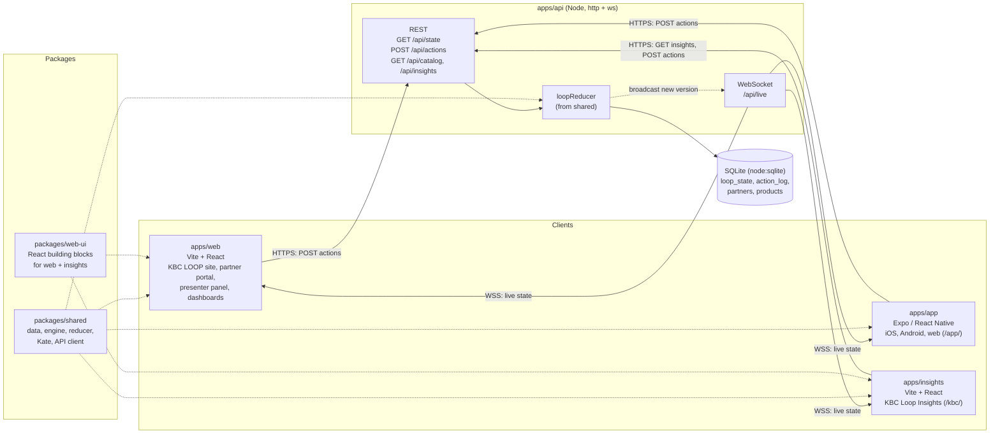
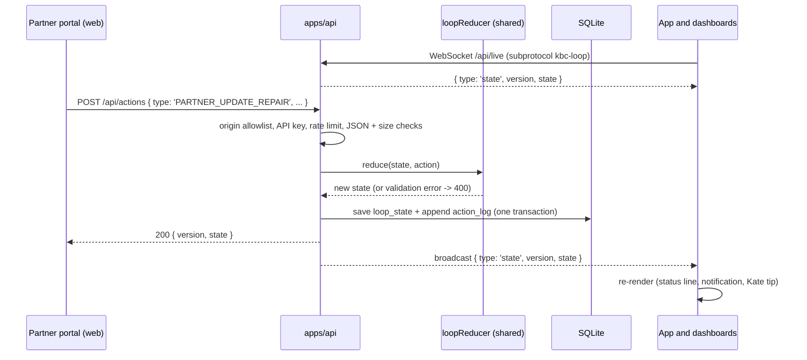

# KBC Loop architecture

KBC Loop is an npm workspaces monorepo with three front ends, one API and one SQLite database. All business
logic (catalogue, pricing, impact, signals, the state reducer) lives in `packages/shared` and runs the same way
in the browser, on the phone and on the server.

See also: [README](../../README.md) for setup and scripts, [DEMO.md](DEMO.md) for the pitch demo, and
[openapi.yaml](openapi.yaml) for the REST contract.

## Overview

In production a single container runs the API, which also serves the built web at `/`, Insights at `/kbc/` and
the app's web export at `/app/`, so everything shares one HTTPS origin.

## Data flow of an action

Example: the partner sets a repair to "Technician on the way" while the customer has the app open.

1. A client builds an action with the helpers in `packages/shared/src/state/actions.js`.
2. The shared API client (`packages/shared/src/client.js`) sends it as `POST /api/actions`.
3. The API checks the request (see below) and applies the pure reducer `loopReducer.js`, which validates the
   action type and its fields.
4. The new state and the action are stored in SQLite; the version number increases.
5. The API pushes the new state over the WebSocket to every connected client, so the web, the app and Insights
   update within the same second, also across devices.

Clients never write over the socket: it is read only. Derived views (costs, impact, dashboards, campaign
results) are computed on the client from the state with the shared `engine/` functions.

## Security model

| Control | Where | What it does |
|---|---|---|
| Origin allowlist | `apps/api/src/security.js` | No `*` in CORS. Only the API's own origin and `ALLOWED_ORIGINS` may call REST or open the WebSocket; others get `403`. |
| API key (optional) | `API_KEY` | `Authorization: Bearer <key>` or WebSocket subprotocol `key.<key>`, compared in constant time. Required on everything except health checks when set. |
| Rate limits | `apps/api/src/security.js` | Per IP address: 60 writes and 600 reads per minute. Behind a proxy only the trusted hop's `x-forwarded-for` entry counts (`PROXY_HOPS`). |
| Input validation | `server.js`, `loopReducer.js`, `partnerFeed.js` | Known action types only, `application/json` only, 16 kB body limit, 1 kB WebSocket messages, strict feed validation, generic error messages. |
| Security headers | API + static server | CSP (`script-src 'self'`, `frame-ancestors 'self'`, `object-src 'none'`), `nosniff`, `SAMEORIGIN`, `no-referrer`, Permissions-Policy, COOP, HSTS in production. |
| Transport | `packages/shared/src/client.js` | Production builds only talk `https`/`wss`; plain `http`/`ws` is allowed for `localhost` and in development only. |
| No secrets in clients | build config | `VITE_*` and `EXPO_PUBLIC_*` values are public. The optional key only keeps casual traffic out; no real credentials ship in any bundle or in the repo. |
| Supply chain | Dockerfile, CI | `npm ci --ignore-scripts` from the lockfile; the container runs as non-root with a read-only code directory. |

## Packages

- `packages/shared`: plain JavaScript, no React. `data/` (fictional customers, partners, products),
  `engine/` (pricing, costs, impact, signals, insights, campaigns), `state/` (reducer, actions, derive),
  `kate/` (conversation engine) and `client.js`.
- `packages/web-ui`: React hooks and components shared by `apps/web` and `apps/insights` (`useLoop`, Kate panel,
  styles, logo).

## Continuous integration

`.github/workflows/ci.yml` (repository root) runs on every push and pull request to `main`: Node 24,
`npm ci --ignore-scripts`, `npm test` (shared + API tests + README check), `npm run lint` and `npm run build`.
